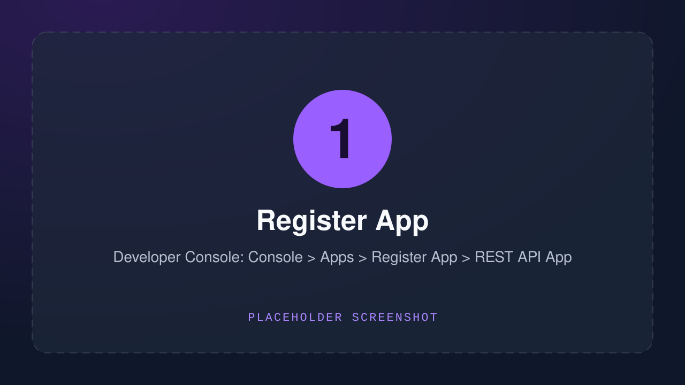
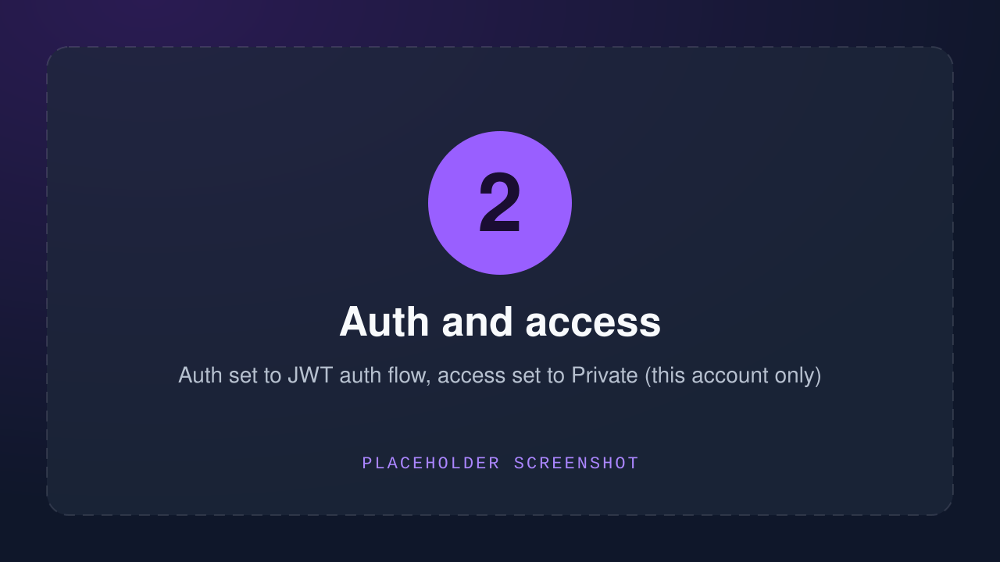
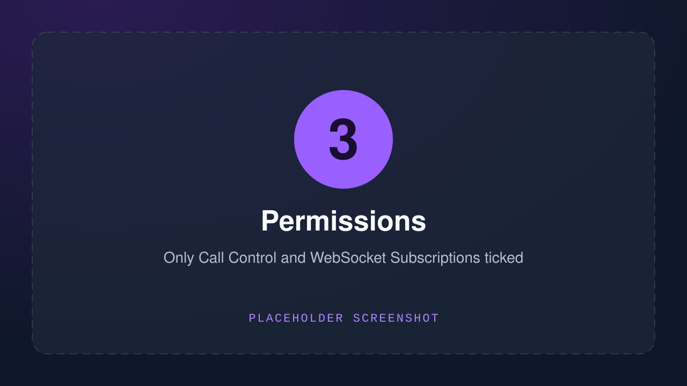
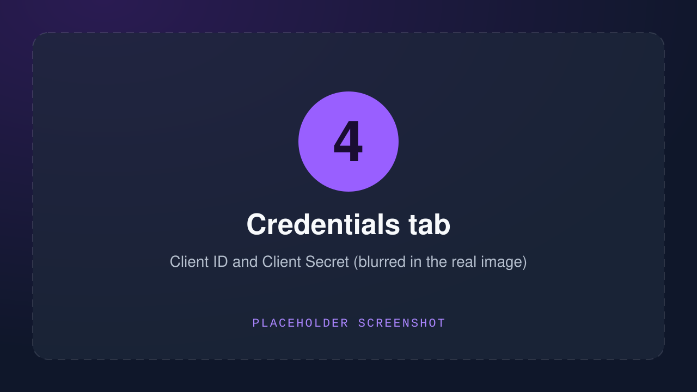
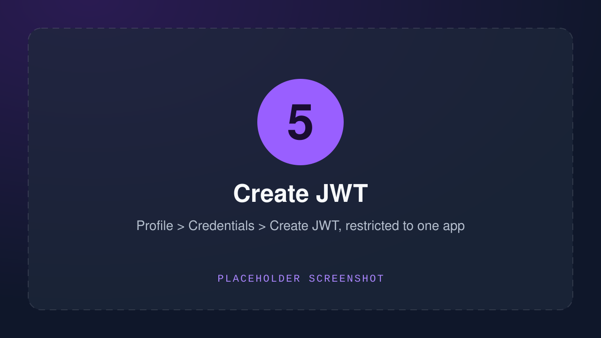
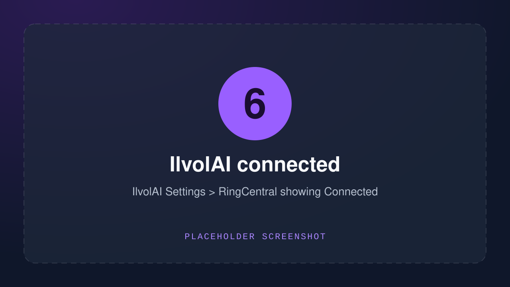

## What this does

Once connected, IlvolAI sees when you **pick up** and **hang up** a RingCentral call, and starts and stops the recording for you. You no longer have to press the microphone button.

IlvolAI only learns two things about a call: **when it starts and stops**, and **the caller's number**. It never receives the call audio from RingCentral. The audio is still captured on your own PC, like before.

Each company connects through its own small **private RingCentral app**. Only your company's account can use it, so no one else gets access to your calls.

The setup has three parts:

1. **Part 1** is done once per company, by the RingCentral admin.
2. **Part 2** is done by each dispatcher.
3. **Part 3** is done in IlvolAI, by each dispatcher.

> [!NOTE] Are you the admin and a dispatcher?
> Then do all three parts yourself, in order.

## Part 1: The RingCentral admin (once per company)

Only one person in the company does this. At the end they give the **Client ID** and **Client Secret** to the dispatchers.

1. Go to [developers.ringcentral.com](https://developers.ringcentral.com) and sign in with your normal RingCentral login.

2. Open **Console**, then **Apps**, then click **Register App**. Choose **REST API App**.

   

   > [!TIP] Register App is greyed out?
   > Your user needs a role that includes **Developer Portal Access**. In the RingCentral **Admin Portal**, go to **Users**, then **Roles**, and add that permission to your role (or ask the account owner to do it). Then sign in again.

3. Set **Auth** to **JWT auth flow**. Set **Access** to **Private, only this account**.

   

4. Under **Permissions**, tick **Call Control** and **WebSocket Subscriptions**. Tick nothing else.

   > [!WARNING] Not "Webhook Subscriptions"
   > Choose **WebSocket** Subscriptions, not Webhook Subscriptions. The two names look almost the same, and mixing them up is the most common mistake. With the wrong one, IlvolAI connects but never sees your calls.

   

5. Open the **Credentials** tab. Copy the **Client ID** and the **Client Secret**, and send them to your dispatchers privately (see [Keep your keys safe](#keep-your-keys-safe)).

   

## Part 2: Each dispatcher

Every dispatcher makes their own personal key, called a **JWT**. It lets IlvolAI act on your calls only.

1. Go to [developers.ringcentral.com](https://developers.ringcentral.com) and sign in. Click your **profile** (top right), then **Credentials**, then **Create JWT**.

   

2. Choose **Only specific apps** and paste the app's **Client ID** from the admin.

3. Pick a **long expiry**, so you do not have to redo this every few weeks.

4. Click **Create** and **copy the JWT**.

> [!WARNING] The JWT is shown only once
> If you close the page before copying it, you cannot see it again. Just create a new one.

## Part 3: In IlvolAI

1. Open IlvolAI and go to **Settings**, then **RingCentral**.

2. Paste the **Client ID**, the **Client Secret** and your **JWT** into the three boxes.

3. Click **Connect**. After a moment it shows **Connected**.

   

4. Choose what IlvolAI does when you answer a call:

   - **Ask** shows a small popup, "Record this call?", every time.
   - **Always** records every call you answer, without asking.
   - **Off** does nothing. You stay connected but record by hand.

## Turning it off

- In IlvolAI, open **Settings**, then **RingCentral**, and click **Disconnect**.
- To be completely sure, also delete your JWT: on developers.ringcentral.com open your **profile**, then **Credentials**, and delete it. This switches IlvolAI off **immediately**, even if IlvolAI is closed.

## What can go wrong

Find the message IlvolAI shows, and follow the fix next to it.

| What IlvolAI says | What to do |
| --- | --- |
| "RingCentral doesn't recognise this Client ID and Client Secret" | Copy both again from the Credentials tab. Make sure there are no spaces before or after. |
| "RingCentral didn't accept this JWT" | Create a new JWT and paste **all** of it. It is very long, so make sure nothing is cut off. |
| The JWT has expired | Create a new JWT (Part 2) and paste it in. Next time pick a longer expiry. |
| The JWT was made for a different app | Create a new JWT and set it to **Only specific apps**, using this app's Client ID. |
| The app is not set up for JWT | Ask the admin to open the app and set **Auth** to **JWT auth flow**. |
| The app is missing **Call Control** | Ask the admin to add the **Call Control** permission. |
| The app is missing **WebSocket Subscriptions** | Ask the admin to add **WebSocket Subscriptions**. Not Webhook Subscriptions. |
| "Couldn't reach RingCentral" | Check your internet connection. If it works for other sites, ask the admin to check the server address in the RingCentral settings. |

After the admin changes anything in the app, press **Connect** again in IlvolAI.

## Keep your keys safe

The **Client Secret** and the **JWT** are like passwords.

- Never post them in a group chat, an email to many people, or a screenshot. Blur them out first.
- Send them to one person at a time, privately.
- IlvolAI keeps them in the Windows secure store (**Credential Manager**), not in a plain file.
- If a box ever pops up asking for a RingCentral **username and password**, press **Cancel**. IlvolAI never needs it.
